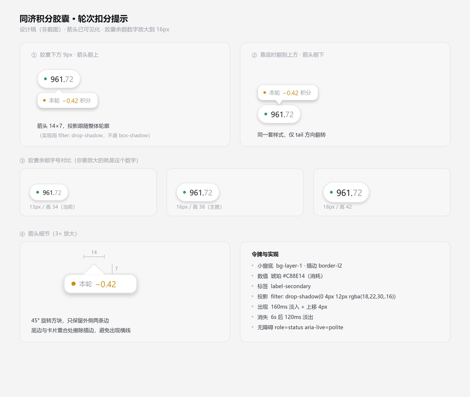

# dsh-tongji-points
[README-github.md](https://github.com/user-attachments/files/34282514/README-github.md)

# dsh-tongji-points

> 查询同济 [agi.tongji.edu.cn](https://agi.tongji.edu.cn) 免费 token 积分余额的 DeepSeek Harness 插件。

[](https://github.com/tempestcmr-oss/dsh-tongji-points/releases/latest)
[](https://github.com/tempestcmr-oss/dsh-tongji-points/blob/main/LICENSE)


在 DSH 窗口里浮一个可拖动的小胶囊，实时显示剩余积分。一轮对话结束自动刷新，并在下方弹出本轮消耗了多少。

```
  ● 961.72
     ▽
  ● 本轮 -0.42 积分
```

上方是常驻胶囊：单击展开设置面板，按住拖动位置。下方是每轮结束弹出的消耗提示，6 秒后自动淡出。



## 特性

- **悬浮可拖动** —— 挂在 `shell.overlay` 上，覆盖整个窗口，位置记在 localStorage
- **轮次自动刷新** —— 一轮对话结束自动拉取余额，并提示本轮消耗
- **主题自适应** —— 全部使用 DSH 主题令牌，浅色 / 深色自动跟随
- **本地优先** —— token 只存在本机，请求由 Host 进程转发，无第三方服务器、无遥测
- **零依赖** —— 不需要 `pnpm install` 装任何东西

## 环境要求

| 项 | 要求 |
|---|---|
| DSH | 桌面版或 Web 版 |
| 网络 | 能访问 `https://agi.tongji.edu.cn`（**校园网内或已连学校 VPN**） |
| 凭证 | 该平台的登录 token（JWT，24 小时有效） |

## 安装

**1. 下载**

到 [Releases](https://github.com/tempestcmr-oss/dsh-tongji-points/releases/latest) 下载最新的 `dsh-tongji-points-x.x.x.zip`。

**2. 解压到固定位置**

比如 `C:\Users\你\dsh-plugins\dsh-tongji-points`。

> ⚠️ 不要放临时目录或解压软件的缓存目录 —— DSH 装的是**软链接**，源目录被清掉插件就失效了。

**3. 安装**

```bash
dsh plugin --profile <你的 profile 名> add <解压出的目录>
```

Windows 桌面版的 profile 名是 `desktop`，CLI 不在 `PATH` 里，用完整路径：

```powershell
& "D:\Deepseek Harness\resources\runtime\cli\bin\dsh.cmd" plugin --profile desktop add "C:\Users\你\dsh-plugins\dsh-tongji-points"
```

看到下面这行就是装好了：

```
+ @dsh-external/dsh-tongji-points link:C:/Users/你/dsh-plugins/dsh-tongji-points
```

**4. 完全重启 DSH**

不是刷新页面 —— Host 侧注册了 HTTP 路由，必须重启进程。

## 获取 token

1. 浏览器打开 <https://agi.tongji.edu.cn> 并登录
2. `F12` → **Network / 网络** 标签
3. 刷新页面，随便点一个 `/api/v1/...` 的请求
4. 在 **Request Headers / 请求标头** 里找 `Authorization: Bearer eyJ...`
5. 复制 `eyJ` 开头的那一整串

## 使用

装好重启后，右上角出现胶囊，**单击**它展开面板，把 token 粘进「访问 token」里点保存即可。

| 操作 | 效果 |
|---|---|
| 按住拖动 | 移动胶囊位置（松手记住） |
| 单击 | 展开 / 收起设置面板 |
| 一轮对话结束 | 自动刷新，下方弹出本轮消耗 |

面板里能看到：当前余额、套餐名、距离下次重置多久、凭证到期时间、上次更新时间。

### 状态说明

| 胶囊显示 | 含义 |
|---|---|
| `961.72` | 正常，绿点 |
| `···` | 正在读取 |
| `设置` | 还没配 token，琥珀点 |
| `已过期` | token 失效（401），琥珀点 |
| `离线` | 连不上平台，灰点 |

token 有效期 **24 小时**。平台没有 refresh 接口，过期后重新粘一次即可。

## 工作原理

```
浏览器                                主进程
──────                                ──────
胶囊组件  ──GET /tongji-points/overview──▶  转发到 agi.tongji.edu.cn
（同源请求）                            （带 Bearer token）
```

**为什么不让浏览器直连？** 桌面版窗口的页面源是 `dsh-app://app/`，跨协议请求要看自定义协议的 fetch 支持。走 Host 代理后浏览器请求是同源的，TLS 由 Node 负责，也不受平台 CORS 策略变化影响。token 只在这一次请求里经过，Host 不落盘。

**轮次结束怎么感知？** 订阅客户端事件 `api-session/status`，回调签名是 `(sessionId, running)`。`running` 由 `true` 转 `false` 即一轮结束。之后等 1.5 秒让平台结算，再拉一次余额算差额；差额 ≤ 0.0005 时再等 1.5 秒重试一次，避免平台延迟导致误报「未扣积分」。

## 常见问题

<details>
<summary>胶囊显示「离线」</summary>

连不上平台。检查是否在校园网内或 VPN 已连接：

```bash
curl -I https://agi.tongji.edu.cn
```
</details>

<details>
<summary>一轮结束没弹小窗</summary>

轮次钩子通过 `ctx.remote.$on` 挂载，极少数情况下取不到。此时**胶囊本身照常工作**（只是没有自动刷新），手动点面板里的「刷新」即可。
</details>

<details>
<summary>为什么一轮 285k token 只扣了 0.33 积分？</summary>

因为 99% 是**前缀缓存命中**。平台对缓存命中按约 1/10 计价：

```
282,880 × 0.10 ≈ 28,288   ← 缓存读
  1,504 × 1.00 =  1,504   ← 新输入
    942 × 3.00 ≈  2,826   ← 输出（加价）
                ────────
                  32,618  → 0.33 分（100,000 有效 token = 1 分）
```

所以上下文长不贵，贵的是**新输入**和**输出**。
</details>

<details>
<summary>每轮消耗是怎么算的？</summary>

是两次刷新之间的**余额差**。如果你在这期间还在别处调了 API，消耗会一起算进来 —— 这是余额的语义，不是单轮的精确账单。
</details>

## 卸载

```bash
dsh plugin --profile <profile> remove @dsh-external/dsh-tongji-points
```

重启 DSH。localStorage 里的残留可以手动清：

- `dsh.tongji-points.token.v1`
- `dsh.tongji-points.position.v1`

## 许可证

[MIT](LICENSE)

---

<sub>本项目与同济大学官方无关，仅为个人使用的客户端插件。</sub>
